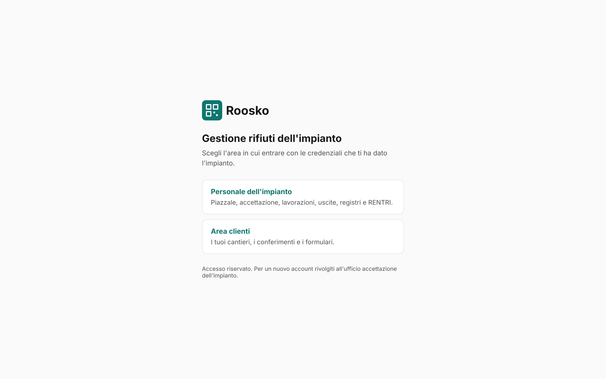

# Roosko — manuale d'uso

Roosko segue ogni contenitore di rifiuto dall'arrivo in impianto all'uscita. Il carico arriva con
il suo formulario (FIR), viene pesato, accettato e diviso in **unità** con etichetta QR. Le unità
vengono stoccate nelle posizioni autorizzate, lavorate e poi spedite. Il registro di carico e
scarico e gli invii RENTRI si scrivono da soli mentre si lavora: non vanno ricopiati in ufficio.

> Le schermate di questo manuale sono prese dall'applicazione vera, avviata con dati di prova
> (impianto di Ravenna, clienti Edilnova e Officine Romagna). Sono in [`img/`](img/).

## Chi usa cosa

| Chi | Dove lavora | Capitolo |
|---|---|---|
| Operatore di piazzale | palmare o telefono, pagina **Operatore (scansione)** | [Piazzale](piazzale.md) |
| Ufficio pesa e accettazione | pannello Roosko, **Conferimenti** e **Uscite** | [Accettazione e uscite](accettazione-uscite.md) |
| Responsabile tecnico | pannello Roosko (dashboard, lavorazioni), pannelli Rifiuti e RENTRI | [Responsabile tecnico](responsabile-tecnico.md) |
| Amministratore | pannelli dei moduli, utenti e permessi | [Amministrazione](amministrazione.md) |
| Cliente dell'impianto | **Area clienti** | [Area clienti](area-clienti.md) |

## Versione PDF

Ogni capitolo esiste anche in PDF, da stampare o consegnare a chi fa quel lavoro:

| PDF | Per chi |
|---|---|
| [roosko-manuale-uso.pdf](pdf/roosko-manuale-uso.pdf) | manuale completo |
| [manuale-operatore-piazzale.pdf](pdf/manuale-operatore-piazzale.pdf) | operatore di piazzale |
| [manuale-accettazione-uscite.pdf](pdf/manuale-accettazione-uscite.pdf) | ufficio pesa e accettazione |
| [manuale-responsabile-tecnico.pdf](pdf/manuale-responsabile-tecnico.pdf) | responsabile tecnico |
| [manuale-area-clienti.pdf](pdf/manuale-area-clienti.pdf) | cliente dell'impianto |
| [manuale-amministrazione.pdf](pdf/manuale-amministrazione.pdf) | amministratore |

Il Markdown e' la fonte. Dopo ogni modifica ai `.md` o alle schermate in `img/` si rigenerano i PDF
con `python3 build-pdf.py` (requisiti nell'intestazione dello script) e si committano insieme.

## Come si entra

*La pagina d'ingresso (`/it`): si sceglie se entrare come personale dell'impianto o come cliente.*

| Area | Indirizzo |
|---|---|
| Pagina d'ingresso | `/it` (in inglese `/en`) |
| Pannello dell'impianto | `/roosko/admin` |
| Pagina dell'operatore | `/roosko/admin/operator` |
| Area clienti | `/roosko/customer` (dopo l'accesso: `/roosko/customer/{codice-cliente}`) |
| Pannelli di gestione dei moduli | `/waste/admin`, `/warehouse/admin`, `/weighing/admin`, `/labeling/admin`, `/processing/admin`, `/rentri/admin` |

Ogni utente vede solo i pannelli per cui ha un ruolo. Se una voce di menu o un pulsante non
compare, non e' un errore dell'applicazione: manca il permesso, e va chiesto all'amministratore.

## Il percorso di un rifiuto

1. **Arrivo**: il mezzo arriva con il FIR. In **Conferimenti** si usa «Registra arrivo» e si pesa il lordo.
2. **Tara**: a scarico avvenuto si usa «Pesa tara». Il peso netto lo calcola il sistema.
3. **Accettazione**: con «Accetta» il carico si divide in unita'. Ogni unita' riceve un QR ed
   entra nel registro. In alternativa si usa «Respingi».
4. **Stoccaggio**: l'operatore scansiona l'unita' e poi la posizione. Il sistema rifiuta le aree
   non autorizzate per quel codice EER e i superamenti dei limiti.
5. **Lavorazione**: dall'unita' scansionata si usa «Avvia trattamento». I prodotti si registrano in
   **Lavorazioni in corso** e diventano nuove unita' con nuova etichetta.
6. **Uscita**: in **Uscite** si crea l'uscita, si caricano le unita' e si usa «Spedisci». Per i
   rifiuti nascono il FIR e lo scarico di registro. Il FIR cartaceo nasce in bozza: si completano
   numero e trasportatore nel pannello Rifiuti e poi si emette.

## Regole che valgono ovunque

- **Prima si scansiona.** Sul piazzale ogni operazione parte dalla scansione di un'etichetta.
- **Lo storico non si cancella.** Registro, movimenti e genealogia delle unita' non si modificano:
  si rettificano, indicando il motivo.
- **Se il sistema dice no, spiega perche'.** Il messaggio dice quale regola e' violata, per
  esempio il limite dell'area superato, e cosa si puo' fare: scegliere un'altra posizione o
  un'altra operazione.
