# Ufficio pesa e accettazione

[← Indice del manuale](README.md)

Pannello Roosko, gruppo **Impianto**: **Conferimenti**, **Lotti**, **Uscite**.

## Conferimenti (ingresso)

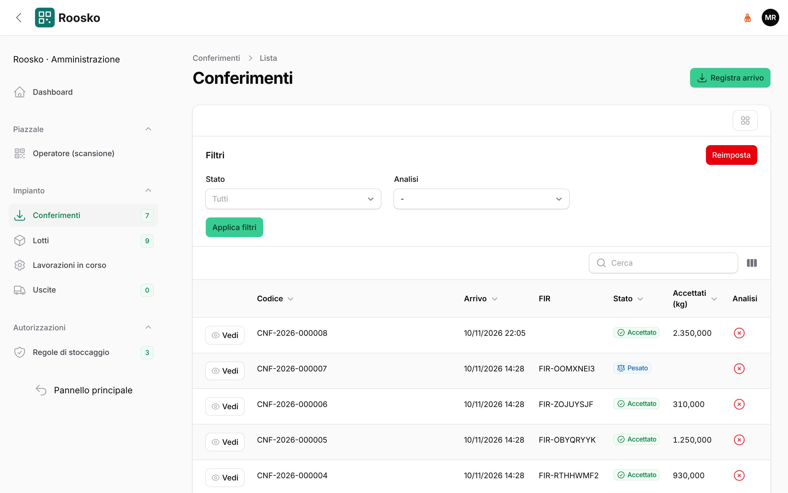

*Elenco dei conferimenti con stato, FIR e chili accettati.*

### 1. Registra arrivo

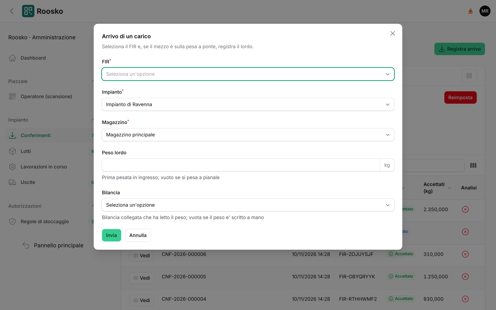

*Registra arrivo: FIR, impianto e magazzino (gia' scelti se ce n'e' uno solo), peso lordo e bilancia.*

Pulsante **Registra arrivo**. Si compilano:

- **FIR**: si cerca per numero. Ogni voce mostra numero, produttore, codice EER e quantita', cosi' si
  riconosce il carico anche quando i numeri si somigliano. Il FIR va registrato prima nel pannello
  Rifiuti, oppure arriva da RENTRI se e' digitale.
- **Impianto** e **Magazzino** di destinazione. Se ce n'e' uno solo sono gia' compilati.
- **Peso lordo** se il mezzo e' sulla pesa a ponte, con la **Bilancia** usata. Si lascia vuoto
  se si pesa a pianale.

Il conferimento nasce nello stato **Arrivato**.

### 2. Pesa tara

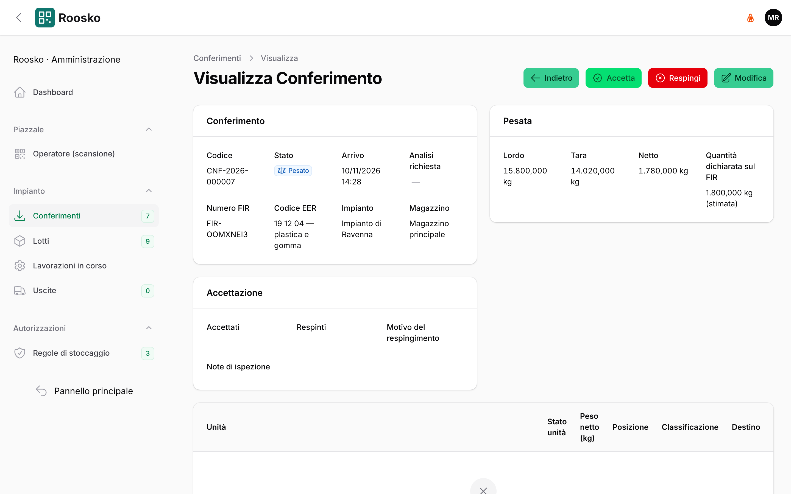

*Conferimento pesato in attesa di decisione: in alto i pulsanti per accettare o respingere.*

A scarico avvenuto, pulsante **Pesa tara**: si inserisce la **Tara** (peso del mezzo vuoto). Il
netto lo calcola il sistema. Stato: **Pesato**.

### 3. Ispezione (facoltativa)

Pulsante **Ispezione**: note di ispezione e la spunta **Analisi richiesta**.

### 4a. Accetta

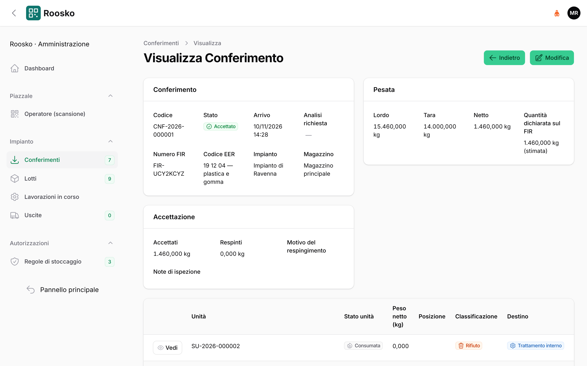

*Conferimento accettato: pesata, accettazione e unita' create.*

Pulsante **Accetta**. Il carico accettato si divide in **unita'**, cioe' i contenitori fisici:

- **Kg accettati** ed eventuali **Kg respinti**, con il **Motivo del respingimento parziale**.
- **Operazione** di gestione (es. *R13 messa in riserva*): si propone quella scritta sul FIR.
- Per ogni unita': **Contenitore**, **Peso netto**, **Tara contenitore** e, se si vuole subito,
  la **Posizione**. La posizione si puo' anche assegnare dopo, con la scansione.

La somma dei pesi netti delle unita' deve coincidere con i kg accettati: se non coincide, il
sistema non accetta.

Il sistema poi crea le unita' con il loro QR e manda in stampa le etichette. Scrive il carico sul
registro e l'accettazione sul FIR; se il FIR e' digitale, invia l'accettazione a RENTRI. Stato:
**Accettato** oppure **Accettato parzialmente**.

### 4b. Respingi

Pulsante **Respingi**, con il **Motivo**. Il carico non entra: non si creano unita' ne' carichi di
registro. Il respingimento viene annotato sul FIR e inviato a RENTRI se il FIR e' digitale. Stato: **Respinto**.

### Stati del conferimento

**Arrivato** → **Pesato** → (**In verifica**) → **Accettato** / **Accettato parzialmente** /
**Respinto** → **Chiuso**. Un conferimento si puo' eliminare solo finche' e' aperto.

## Lotti

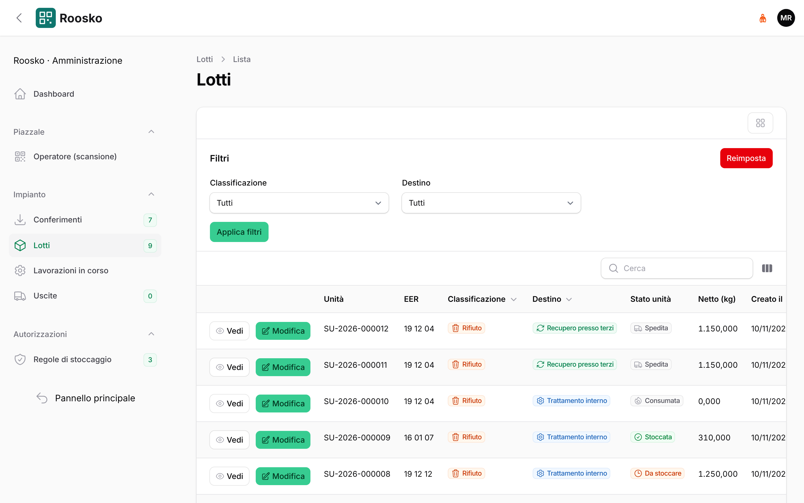

*Lotti con classificazione, destino e stato delle unita'.*

**Lotti** mostra, per ogni unita' accettata o prodotta, il codice EER, la classificazione
(**Rifiuto**, **End of Waste**, **Sottoprodotto**) e il destino (**Trattamento interno**,
**Vendita**, **Recupero presso terzi**, **Smaltimento**, **Bonifica**). Dal dettaglio si vede la
tracciabilita' a monte, cioe' da quali unita' e conferimenti deriva il lotto. Con **Modifica** si
cambiano il destino e i riferimenti End of Waste.

## Uscite

### 1. Nuova uscita

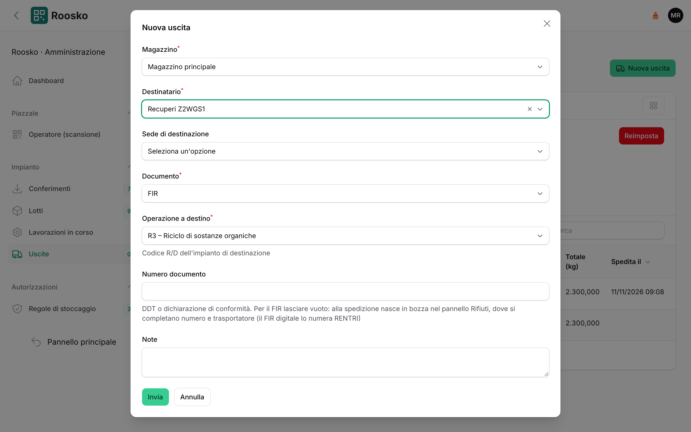

*Nuova uscita: magazzino gia' scelto, destinatario, documento, operazione a destino.*

Pulsante **Nuova uscita**:

- **Magazzino**: e' gia' scelto se ce n'e' uno solo.
- **Destinatario** e **Sede di destinazione**. Con il documento FIR l'elenco mostra solo i soggetti
  registrati come *destinatario*. Se l'impresa che cercate non c'e', va aggiunto il ruolo nel
  pannello Rifiuti → **Soggetti**.
- **Documento**: FIR, DDT o Dichiarazione di conformita' EoW.
- **Operazione a destino**: il codice R/D dell'impianto che riceve.
- **Numero documento**: solo per DDT e dichiarazione. Per il FIR si lascia vuoto (vedi sotto).

### 2. Caricare le unita'

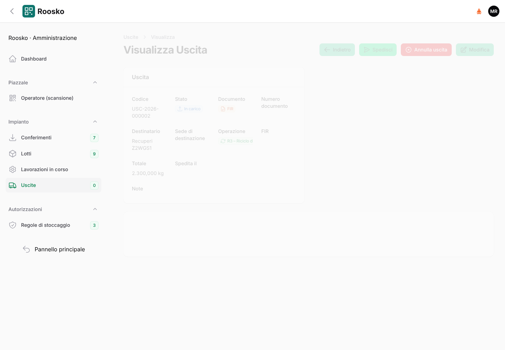

*Uscita in carico: le unita' caricate, il totale e il pulsante Spedisci.*

**Carica unita'**: si scansiona il QR o si digita il **Codice unita'**. Dal piazzale si usa anche
«Aggiungi a uscita». Il sistema controlla che le unita' siano coerenti con il documento, la
classificazione e il destino: per esempio un solo codice EER per FIR. Stato e totale si aggiornano
a ogni unita' caricata o tolta.

### 3. Spedire

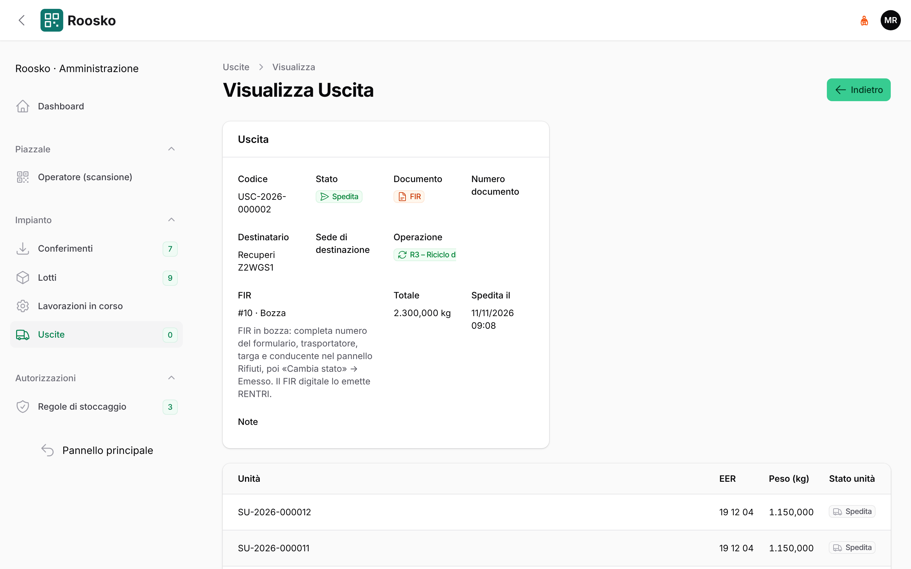

*Uscita spedita: il FIR e' nato in bozza, con il collegamento al pannello Rifiuti.*

**Spedisci**, poi **Conferma**. Le unita' risultano uscite e si scrive lo scarico di registro.

- Per i **rifiuti** nasce il FIR. Se il sito ha la credenziale RENTRI il FIR e' **digitale**: lo emette e
  lo numera RENTRI. Altrimenti e' **cartaceo** e nasce **in bozza**: va completato (passo 4).
- Per l'**End of Waste** serve il numero della dichiarazione e sul registro non si scrive nulla.

### 4. Completare ed emettere il FIR cartaceo

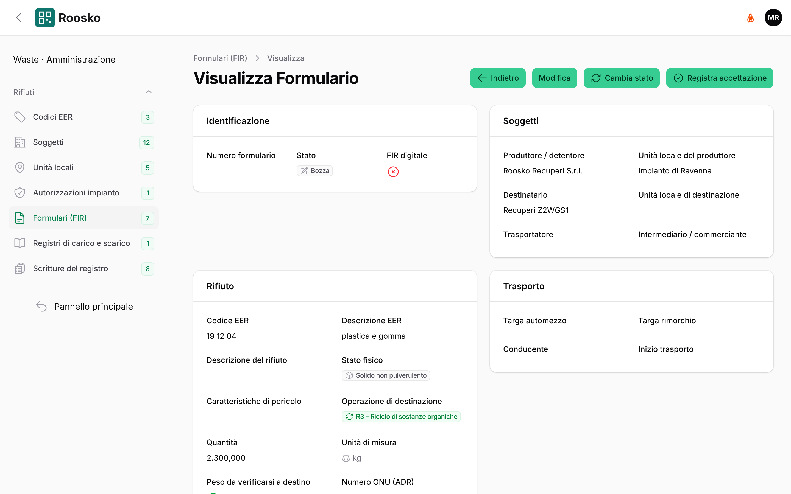

*Il FIR d'uscita in bozza nel pannello Rifiuti: si apre dal campo FIR dell'uscita.*

1. Nella scheda dell'uscita si fa clic sul campo **FIR** (*#numero · Bozza*): si apre il formulario nel
   pannello Rifiuti.
2. **Modifica**: si scrivono il **Numero formulario** del modulo vidimato, il **Trasportatore**, la
   **Targa automezzo** e il **Conducente**, poi **Salva**.

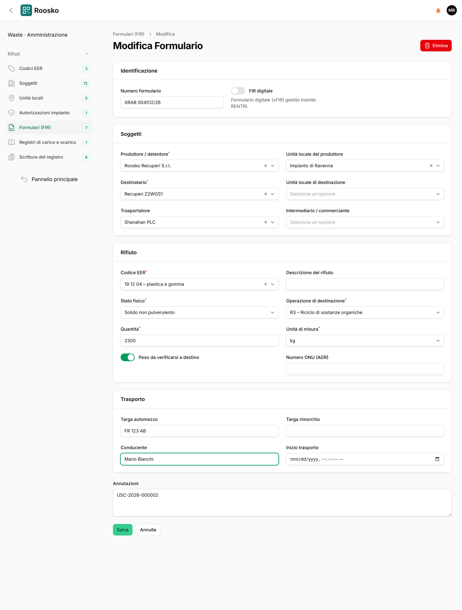

*Modifica del FIR: numero del modulo, trasportatore, targa e conducente.*

3. **Cambia stato** → **Emesso**. Quando il mezzo parte, **Cambia stato** → **In trasporto**.

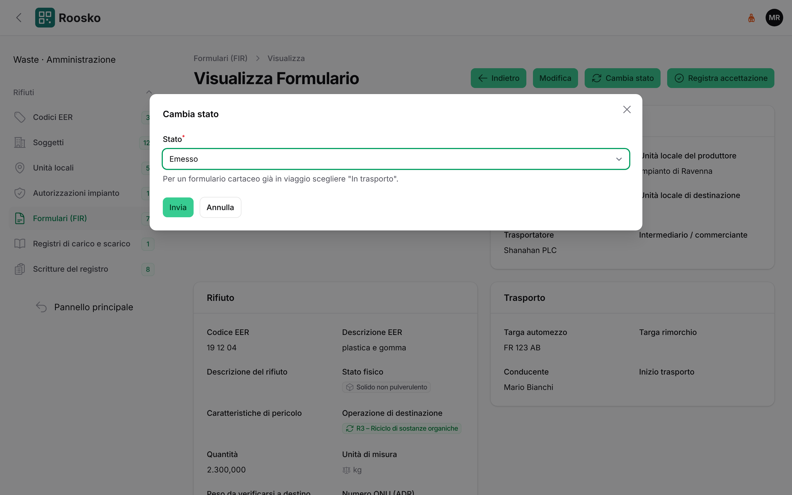

*Emissione del FIR dal pulsante Cambia stato.*

Un FIR cartaceo **non si emette senza numero e trasportatore**: il sistema lo blocca con il messaggio
*Il formulario cartaceo non si può emettere senza numero del formulario e trasportatore*. Dopo
l'emissione il formulario non si modifica piu', quindi i dati vanno controllati prima.

Stati dell'uscita: **Bozza** → **In carico** → **Pronta** → **Spedita** → **Consegnata**
(oppure **Annullata** prima della partenza).

### Togliere un'unita' o annullare un'uscita

- **Togli**, sulla riga di un'unita' dell'uscita, la toglie dall'uscita e la libera: torna in giacenza
  e si puo' stoccare o caricare altrove.
- **Annulla uscita** annulla un'uscita non ancora spedita e libera tutte le unita' caricate. Un'uscita
  gia' spedita non si annulla: ha generato FIR e scarico di registro.
