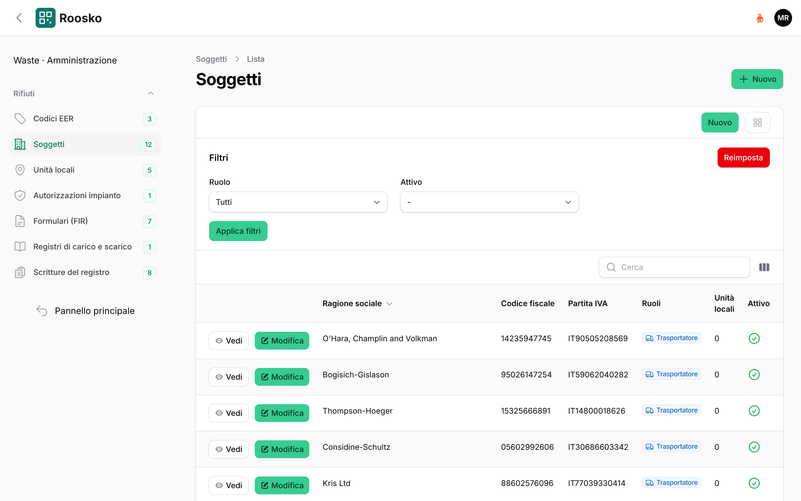
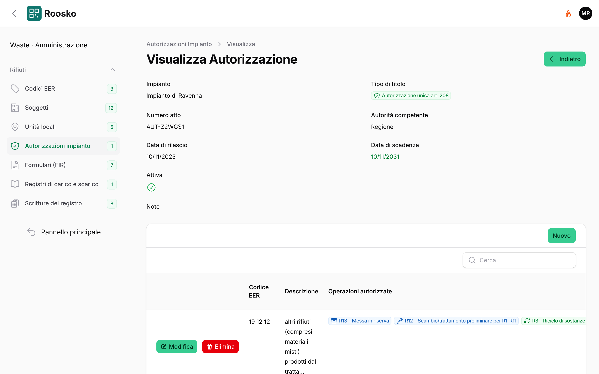
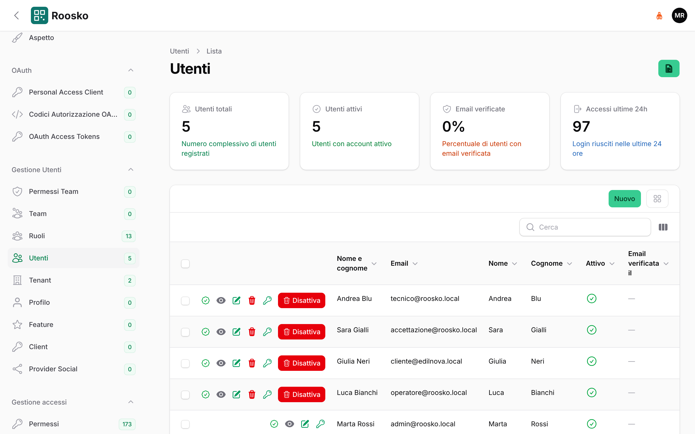

# Amministrazione

[← Indice del manuale](README.md)

## Configurazione iniziale dell'impianto (in quest'ordine)

*Soggetti nel pannello Rifiuti: ogni impresa con i suoi ruoli.*

1. **Rifiuti → Soggetti**: l'impresa che gestisce l'impianto, poi produttori, trasportatori e
   destinatari. I ruoli contano: nelle uscite con FIR si possono scegliere solo i soggetti con ruolo
   *destinatario*, e nel FIR il trasportatore va scelto tra chi ha il ruolo *trasportatore*.
   **Unita' locali**: le sedi; quella dell'impianto ha la spunta di impianto.
2. **Rifiuti → Autorizzazioni impianto**: l'atto autorizzativo con i codici EER, le operazioni e i limiti.
   Le operazioni elencate qui sono le sole proposte all'operatore quando avvia un trattamento.

*Autorizzazione dell'impianto: titolo, scadenza e, sotto, i codici EER con le operazioni ammesse.*
3. **Magazzino** (`/warehouse/admin`): **Magazzini**, **Aree** e **Posizioni**. La **Mappa
   magazzino** mostra la disposizione. Conviene assegnare un'etichetta a ogni posizione: il piazzale la scansiona.
4. **Autorizzazioni → Regole di stoccaggio** (pannello Roosko): quali codici possono stare in
   quale area. Senza regole un'area non accetta rifiuti.
5. **Pesatura** (`/weighing/admin`): le bilance.
6. **Etichettatura** (`/labeling/admin`): stampanti e modelli di etichetta.
7. **Lavorazioni** (`/processing/admin`): le macchine.
8. **RENTRI** (`/rentri/admin`): le credenziali delle unita' locali.

## Messa in produzione e controlli

Rilascio e controlli sono descritti nel [runbook di produzione](../operations/production-runbook.md).
In breve:

- si rilascia con `./deploy.sh` dalla radice del progetto: backup, dipendenze, link degli asset,
  migrazioni, cache, riavvio delle code;
- alla fine `php artisan roosko:production-check` controlla:
  - configurazione: debug spento, https, chiave;
  - code e scheduler;
  - cartelle scrivibili e asset;
  - comuni, impianto, autorizzazioni e credenziale RENTRI;

  se c'e' un controllo bloccante il comando lo dice e spiega cosa fare;
- gli asset (pagina operatore, mappe, tema) non si copiano: `public_html/assets/<modulo>` e
  `public_html/themes/<tema>` sono collegamenti relativi alle cartelle `public/` di moduli e temi
  (`php artisan xot:module-link`, `php artisan xot:theme-link`, gia' eseguiti da `deploy.sh`).

## Utenti e accessi

- Il **super amministratore** si crea da riga di comando:
  `php artisan user:super-admin --email=...`. Il comando assegna anche l'accesso a tutti i
  pannelli dei moduli presenti; se in seguito si aggiunge un modulo, va rilanciato.

*Utenti (pannello User, `/user/admin/users`): da qui si creano gli utenti e si assegnano i ruoli.*

- Gli altri utenti si creano nel modulo utenti e ricevono un ruolo. L'accesso a un pannello
  richiede il ruolo con lo stesso nome del pannello (es. `roosko::admin`); le operazioni dentro
  il pannello richiedono i permessi (es. vedere o creare conferimenti).

### Ruoli del personale d'impianto

I ruoli e i permessi si creano con i seeder dei moduli (`php artisan module:seed Roosko`, e lo
stesso per Waste, Warehouse, Processing, Weighing, Labeling, Rentri). A ogni persona si danno **due
cose**: il ruolo operativo, che dice cosa puo' fare, e i ruoli dei pannelli in cui deve entrare.

| Chi | Ruolo operativo | Ruoli dei pannelli |
|---|---|---|
| Operatore di piazzale | `roosko.operator` | `roosko::admin` |
| Pesa e accettazione | `roosko.acceptance` | `roosko::admin`, `waste::admin`, `weighing::admin` |
| Responsabile tecnico | `roosko.technical_manager` | `roosko::admin`, `waste::admin`, `warehouse::admin`, `processing::admin`, `labeling::admin`, `weighing::admin`, `rentri::admin` |

Senza il ruolo del pannello il login a quel pannello risponde «I dati di accesso non sono
corretti», anche con la password giusta: e' il primo controllo da fare quando qualcuno non entra.
Vale anche per il super amministratore creato a mano, che va abilitato ai pannelli con
`user:super-admin`.

## Dare accesso a un cliente all'area clienti

1. Modulo utenti: creare il **cliente** con nome e codice (slug). Il codice compare nell'indirizzo.
2. Creare l'utente del cliente, o usarne uno esistente, e aggiungerlo come **membro** del
   cliente. Un utente puo' essere membro di piu' clienti.
3. Assegnare all'utente il ruolo **`roosko::customer`**.
4. Pannello Rifiuti → **Soggetti** → scheda dell'impresa produttrice: campo **Cliente (area
   clienti)** = il cliente. Un cliente puo' avere piu' soggetti, per esempio un gruppo di imprese.

L'utente entra da `/roosko/customer/login`. Vede solo i cantieri, i FIR e i conferimenti dei
soggetti collegati al suo cliente. Vedi [Area clienti](area-clienti.md).
