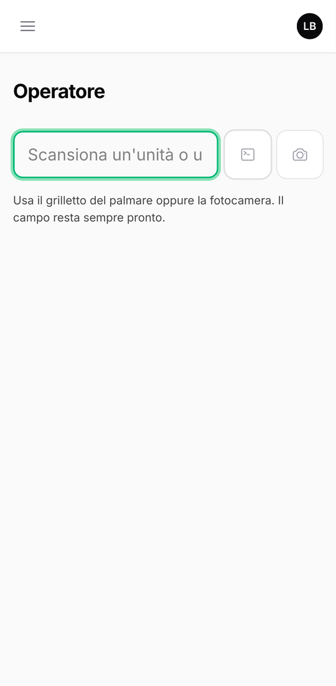
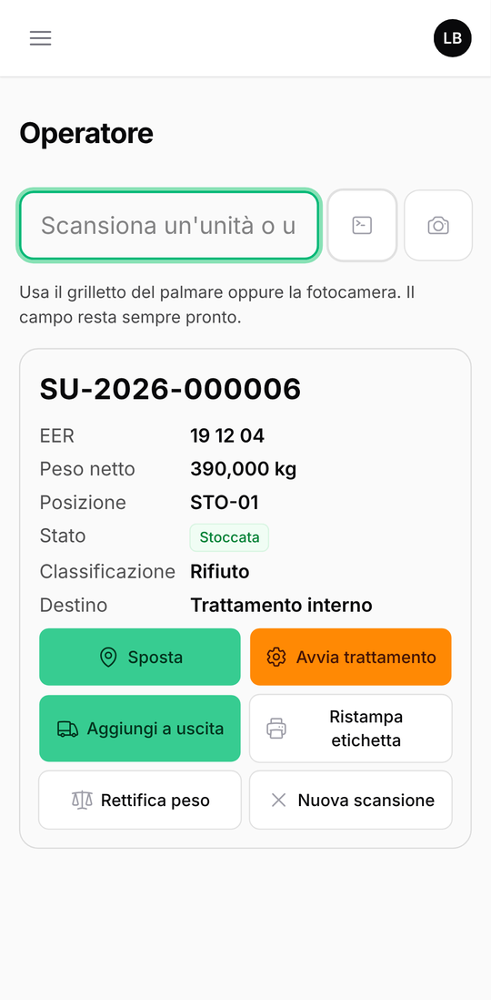
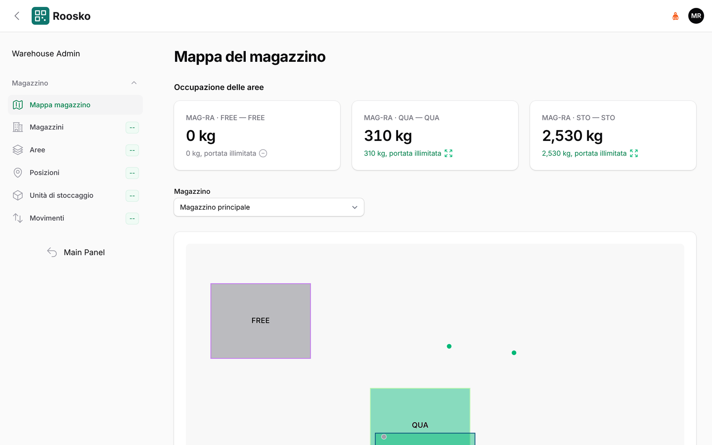

# Piazzale: la pagina dell'operatore

[← Indice del manuale](README.md)

Menu **Piazzale → Operatore (scansione)**. La pagina e' pensata per palmari rugged e telefoni:
pulsanti grandi, usabili con i guanti, e il campo di scansione sempre pronto. Si puo' installare
come app sul telefono (PWA).

## Scansionare

*La pagina dell'operatore sul telefono: campo di scansione sempre pronto, tastiera e fotocamera a destra.*

- Si usa il **grilletto del palmare** oppure il pulsante **Fotocamera**.
- Il campo non apre la tastiera del telefono, per non coprire lo schermo a ogni scansione. Per
  digitare un codice a mano si tocca il pulsante con il simbolo del terminale, accanto al campo: la
  tastiera resta attiva su quel dispositivo finche' non si tocca di nuovo.
- Si scansiona **un'unita'** (l'etichetta del contenitore) **o una posizione** (l'etichetta della
  scaffalatura o della baia).
- «Nuova scansione» svuota la pagina.
- Il messaggio *Codice «…» non riconosciuto* indica un'etichetta rovinata o non assegnata: va
  ristampata o segnalata all'ufficio.

### Scansione di un'unita'

*Dopo la scansione di un'unita': dati dell'unita' e azioni consentite al proprio ruolo.*

Compare la scheda dell'unita': **EER**, **Peso netto**, **Posizione**, **Stato**,
**Classificazione** e **Destino**. Da qui si puo':

| Azione | Quando | Cosa succede |
|---|---|---|
| **Stocca** / **Sposta** | l'unita' va messa o spostata in una posizione | il sistema chiede di scansionare la posizione di destinazione |
| **Avvia trattamento** | l'unita' entra in una macchina (es. trituratore) | si scelgono **Macchina** e **Operazione**; l'unita' viene consumata dal trattamento |
| **Aggiungi a uscita** | l'unita' sta per essere caricata su un mezzo | si sceglie l'**Uscita** in preparazione |
| **Ristampa etichetta** | l'etichetta e' rovinata o persa | si indica il numero di **Copie** |
| **Rettifica peso** | il peso reale e' diverso da quello registrato | si indicano **Nuovo peso netto** e **Motivo** (obbligatorio, resta nello storico) |

### Scansione di una posizione

Compare l'elenco delle **unita' presenti** in quella posizione, oppure *Nessuna unita' in questa
posizione*.

## Stoccare un'unita', passo per passo

*La mappa del magazzino (pannello Warehouse) mostra in ufficio dove sono finite le unita'.*

1. Scansionare l'unita'.
2. Premere **Stocca** (o **Sposta**).
3. Scansionare la posizione di destinazione. Compare la conferma *Unita' … in …*.

Se la posizione non e' ammessa, il sistema blocca l'operazione e spiega il motivo:

| Messaggio | Cosa fare |
|---|---|
| l'area della posizione … non e' autorizzata allo stoccaggio di rifiuti | scegliere una posizione in un'area autorizzata |
| … e' pericoloso e l'area di … non ammette rifiuti pericolosi | portarlo nell'area dei pericolosi |
| il codice … non e' autorizzato nell'area di … | scegliere un'area che accetta quel codice EER |
| limite dell'area superato per … | scegliere un'altra area, oppure avvisare il responsabile tecnico |
| limite autorizzato dell'impianto superato per … | **fermarsi** e avvisare il responsabile tecnico: l'impianto e' al limite dell'autorizzazione |
