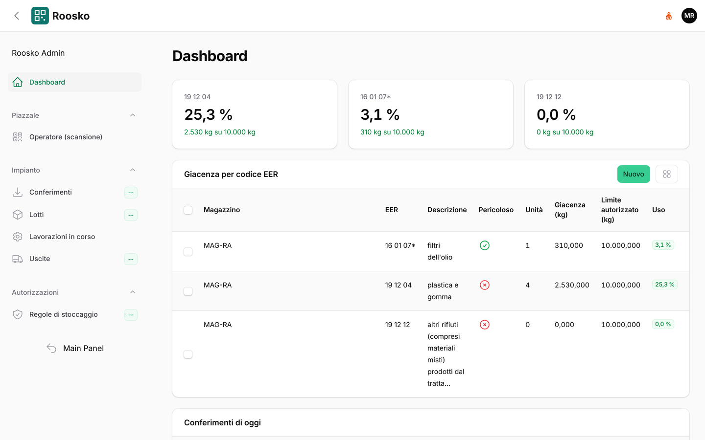
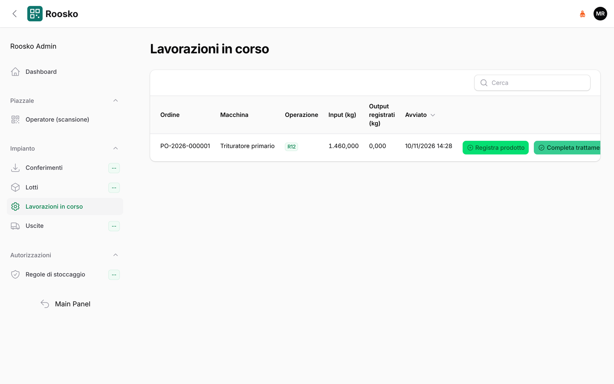
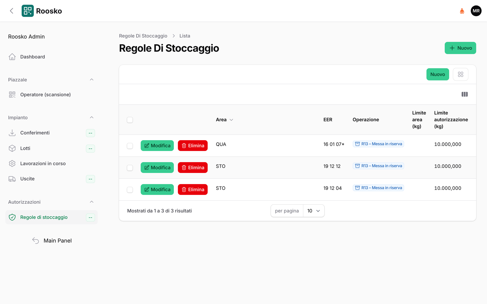
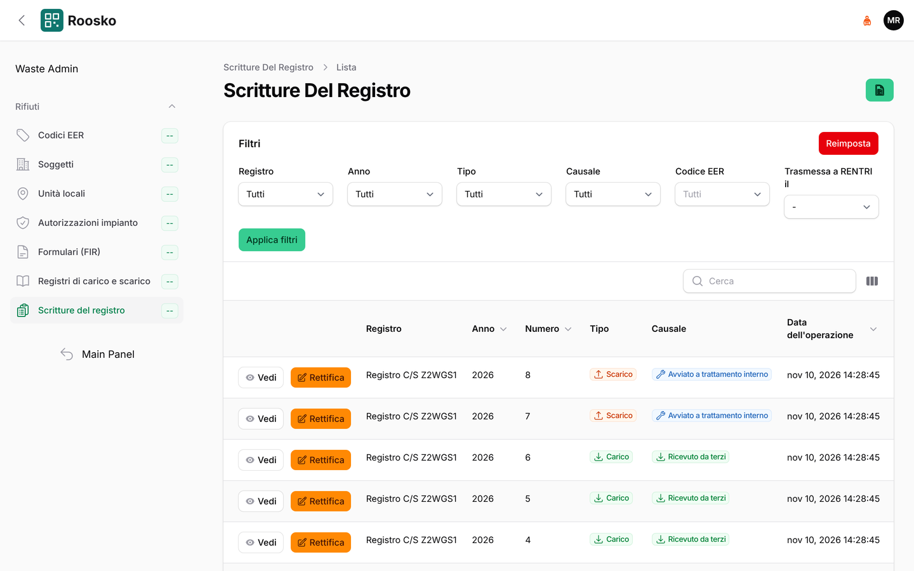
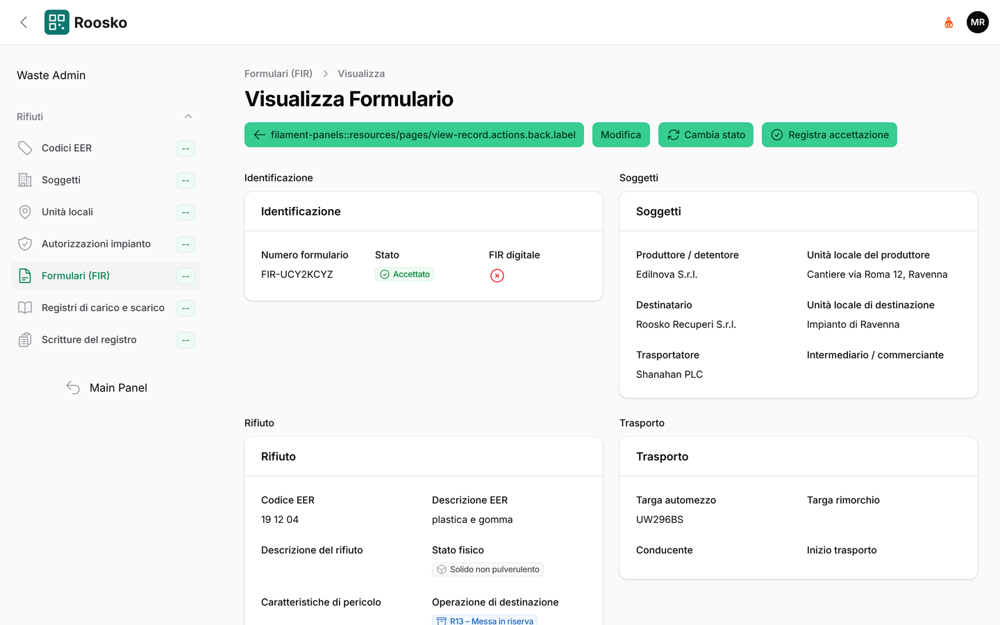
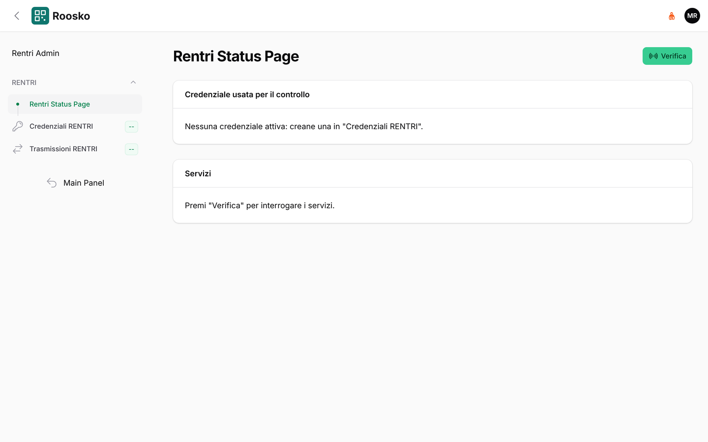

# Responsabile tecnico

[← Indice del manuale](README.md)

## Dashboard impianto

*Dashboard dell'impianto: uso delle autorizzazioni e giacenza per codice EER.*

La home del pannello Roosko mostra tre riquadri:

- **Uso dei limiti autorizzati**: per ogni codice autorizzato, la giacenza rispetto al limite di
  stoccaggio istantaneo, con soglie di attenzione. Il limite **annuo** oggi non e' calcolato in
  questo riquadro.
- **Giacenza per codice EER**, per magazzino.
- **Conferimenti di oggi**.

## Lavorazioni in corso

*Lavorazioni in corso con i pulsanti per registrare il prodotto e completare il trattamento.*

Menu **Impianto → Lavorazioni in corso**: i trattamenti avviati dal piazzale, con **Ordine**,
**Macchina**, **Operazione**, **Input (kg)**, **Output registrati (kg)** e ora di **Avvio**.

- **Registra prodotto**: ogni prodotto diventa un'unita' con QR ed etichetta. Si indicano
  **Codice EER**, **Stato fisico**, **Classi di pericolo (HP)** (obbligatorie per un codice
  pericoloso), **Classificazione**, **Destino**, l'eventuale **Codice lotto End of Waste**,
  **Contenitore**, **Peso netto** e **Tara contenitore**. Se il prodotto e' ancora un rifiuto, viene
  scritto il carico di nuova produzione sul registro.
- **Completa trattamento**: il sistema calcola il bilancio di massa tra input e prodotti e scrive la
  genealogia delle unita'. Se la perdita di massa supera la soglia configurata, la chiusura si
  blocca; **Forza la chiusura** la permette comunque. Dopo la chiusura non si registrano piu' prodotti.

## Regole di stoccaggio

*Regole di stoccaggio: quali codici EER e operazioni sono ammessi in ogni area.*

Menu **Autorizzazioni → Regole di stoccaggio**: per ogni **area** del magazzino si indica quali
codici autorizzati puo' contenere, con quale operazione e con quale limite in kg. Un'area senza
regole non accetta rifiuti. Queste regole sono quelle che il piazzale si vede applicare alla
scansione (vedi [Piazzale](piazzale.md)).

## Rifiuti (pannello `/waste/admin`, gruppo «Rifiuti»)

*Scritture del registro di carico e scarico, con il pulsante Rettifica.*

- **Autorizzazioni impianto**: atti autorizzativi, codici EER autorizzati, operazioni e limiti
  (istantaneo e annuo).
- **Formulari (FIR)**: tutti i formulari, in ingresso e in uscita.
- **Registri di carico e scarico** e **Scritture del registro**: le scritture nascono dalle
  operazioni (accettazione, trattamento, spedizione) e non si modificano. Un errore si corregge
  con una **rettifica** motivata.
- **Codici EER**, **Soggetti** (produttori, trasportatori, destinatari) e **Unita' locali**.

## RENTRI (pannello `/rentri/admin`)

*Dettaglio di un FIR: identificazione, soggetti, rifiuto e trasporto.*

**Firma FIR** (elenco *Trasmissioni RENTRI*) firma un FIR digitale con la firma remota RENTRI: si
inserisce il **PIN di firma** dell'utente della credenziale, che non viene salvato. L'esito arriva
con la verifica della transazione e compare nella trasmissione.

*Stato dei servizi RENTRI: senza credenziali attive la pagina lo segnala.*

- **Credenziali RENTRI**: certificato e ambiente (demo o produzione) per unita' locale.
- **Trasmissioni RENTRI**: ogni invio con il suo esito. Le trasmissioni in attesa vengono
  ricontrollate automaticamente ogni minuto.
- **Stato servizi RENTRI**: raggiungibilita' dei servizi.

> Nota per l'avvio in produzione: l'integrazione RENTRI va prima provata sull'ambiente demo.
> Vedi il backlog dell'audit, voce B-06.
